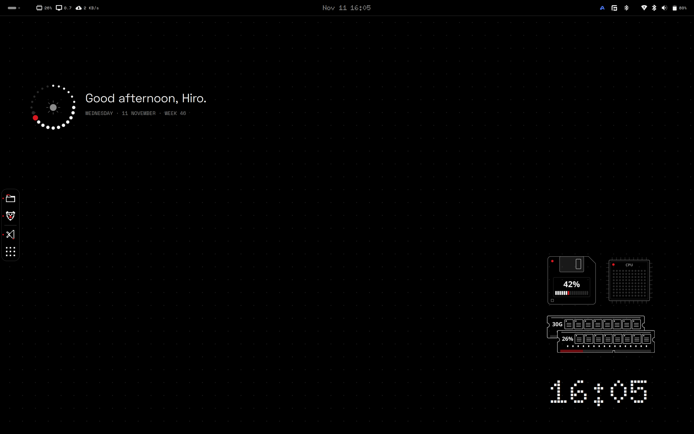
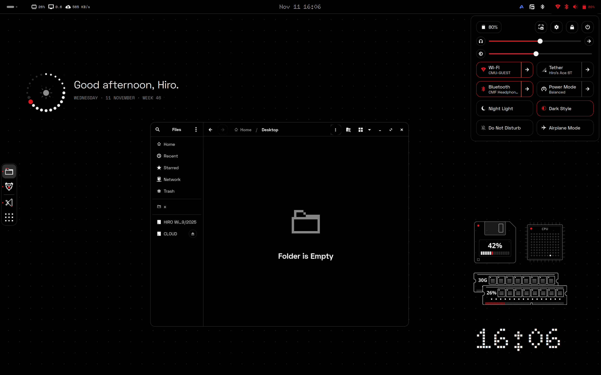
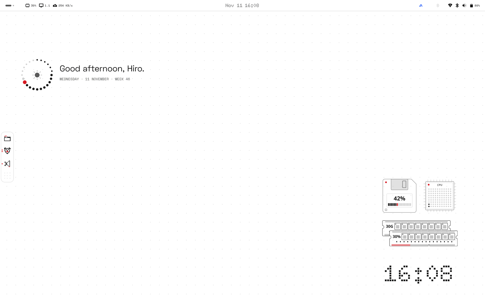
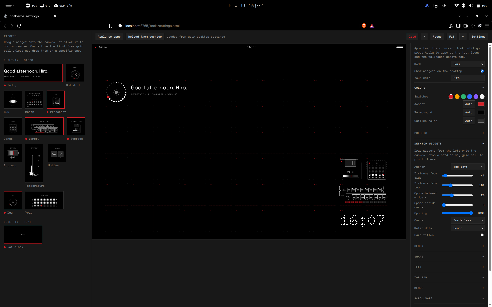

# notheme

A Nothing-inspired theme for Ubuntu: black or white surfaces, thin outlines, pixel icons, and restrained red accents.

**Target:** Ubuntu 26.04 with GNOME Shell 50. GTK4/libadwaita overrides and lock-screen styling are experimental; appearance can vary between applications.



| | |
| --- | --- |
|  |  |
| Quick Settings and a themed Files window | Light mode |



## Features

- Dark and light modes with customizable colors, fonts, corners, spacing, and scrollbars.
- GNOME panel, menus, calendar, Quick Settings, notifications, and dock styling.
- Desktop widgets with a visual browser in the settings page: dot clock, a date-and-greeting card, dot dial, sky (sun by day, moon by night) phase, month, CPU graph, per-core bars, round memory/storage/day gauges, battery cells, temperature gauge, uptime, and year progress. Every widget has a fixed shape (1x1, 1x2, 2x1, 2x2 or 3x1 grid units), snaps to a grid, and can be pinned to any cell.
- GTK3 theme, optional GTK4 overrides, pixel icons, wallpaper, and a bundled pixel cursor (white, black outline, red accent, animated spinner).
- Optional terminal, zsh, Starship, btop, and Cava configurations.
- Preview-first installation, automatic backups, and drift-aware restore.

## Requirements

Install missing dependencies yourself:

```bash
sudo apt install python3 python3-gi libglib2.0-bin fontconfig \
  yaru-theme-gtk papirus-icon-theme
```

Optional applications (kitty, btop, Cava, Starship) must be installed separately; the pixel cursor is bundled and needs no package. The installer does not download assets, install packages, or change your login shell.

## Install

Run from this directory as your normal desktop user, **not with sudo**:

```bash
./notheme doctor
./notheme apply                    # preview
./notheme apply --yes              # install with backups
```

Log out and back in after installation. Extension enablement is preserved: a new or disabled extension is not enabled automatically. Add `--enable-extension` when you want to activate it. Do not run `notheme@local` together with its predecessor, the `glyph-ubuntu@local` extension (this project's earlier name); the installer refuses to enable one while the other is active.

### All supported components

```bash
./notheme apply --all              # preview
./notheme apply --all --yes         # install all supported assets and app configs
```

`--all` includes dock settings, GTK3/GTK4 user overrides, and every supported app config. It changes existing application and shell-startup configuration, with backups. The native zsh prompt takes precedence over Starship; Starship initialization is not added. Shell activation still requires `--enable-extension`. GDM login theming is not included.

### Options

| Option | Effect |
| --- | --- |
| `--yes` | Apply changes; otherwise preview only |
| `--all` | Select all supported theme assets and app configurations |
| `--enable-extension` | Explicitly enable `notheme@local` |
| `--dock` | Configure the existing Ubuntu Dock |
| `--libadwaita` | Opt into global GTK4 CSS overrides |
| `--gtk3-overrides` | Opt into GTK3 user CSS overrides for conflicting custom styles |
| `--cursor NAME` | Select an installed cursor at 24px; default is the bundled `notheme-cursor` |
| `--cursor keep` | Preserve the current cursor and size |
| `--apps ...` | Select `kitty`, `terminal`, `zsh`, `starship`, `btop`, or `cava` |

For example, to theme GNOME Terminal and its zsh prompt:

```bash
./notheme apply --yes --apps terminal zsh
```

Use `./notheme apply --help` for the complete command reference. `./notheme build` renders every asset into `build/` without touching your desktop, which is handy for inspecting the output.

The installer checks that the running GNOME Shell is version 50 and stops before making any change if it is not.

### Cursor

`notheme-cursor` is a pixel cursor drawn for this project (`tools/cursor.py`): white with a black outline and a red accent, an animated dot-ring spinner, and the full set of resize, move, grab, zoom and not-allowed shapes. It ships at 24, 36, 48, 72 and 96px, in whole-pixel steps so edges stay sharp.

```bash
./notheme apply --yes --cursor Yaru    # use another installed cursor theme instead
./notheme apply --yes --cursor keep    # leave your current cursor and size alone
```

`./notheme restore` puts your previous cursor setting back.

## Customize

```bash
./notheme settings                     # then open http://localhost:8765
./notheme settings --port 9000         # use another port
```

One page edits every option and writes it to your desktop settings as you change it, so the top bar, menus and widgets update live. Nothing else is reachable: the server listens on localhost only.

- **Apply to apps:** lights up when you change something apps use (colors, corners, fonts, scrollbars); press it to restyle GTK apps, icons and the wallpaper.
- **Theme, colors, shape, text, scrollbars:** a Theme menu with notheme, Gruvbox, Nord, Dracula, Catppuccin, Solarized, Tokyo Night and Rosé Pine, each with a dark and a light variant (the Mode menu switches between them, so Gruvbox Dark becomes Gruvbox Light); accent swatches and custom colors, shape presets, corner roundness, outlines, selection style, fonts, text sizes.
- **Desktop widgets:** drag any widget, text or card, onto the grid, or drop it on a specific cell to pin it there. Anchor corner, distance from edges, size, opacity, card and dot style, clock format, greeting name. The canvas is your real display size and shows a miniature top bar.
- **Top bar, menus, lock screen, advanced:** bar height, clock size, spacing, menu padding, lock-screen styling, shell styling, and reset.
- **Preview data:** fake CPU, memory, storage, battery and temperature readings for designing cards.

## Add your own widget

```bash
./notheme widget new my-widget --name "My Widget"
```

See [extension/widgets/README.md](extension/widgets/README.md) for the widget format, and [CONTRIBUTING.md](CONTRIBUTING.md) for development and tests.

## zsh prompt

Set options above the managed source block in `.zshrc`:

```zsh
NOTHEME_PROMPT_STYLE=compact   # default: two-line
NOTHEME_PROMPT_GIT=1           # default: 1
NOTHEME_PROMPT_TIME=1          # default: 0
NOTHEME_PROMPT_USER=1          # default: 0
NOTHEME_PROMPT_ASCII=1         # default: 0
```

Start a new shell after installing. Existing prompt frameworks may need their own theme disabled.

## Restore

```bash
./notheme doctor                       # status and backup IDs
./notheme restore                      # undo the newest active transaction
./notheme restore --backup BACKUP_ID    # restore a specific transaction
```

Restore multiple installations newest first. Backups are stored under `${XDG_STATE_HOME:-~/.local/state}/notheme/backups/`; backups from the previous project name are also recognized. Keep them until you are satisfied with the result.

Restore preserves files and settings changed after installation. Use `--force` only if you intend to discard those later changes. Log out and back in after restoring extension files.

If the desktop becomes unstable, save your work, disable `notheme@local`, and set Shell to **Default** in Tweaks. Avoid further theme changes while checking stability. Do not restart GDM or run `gnome-shell --replace` in the active session.

## Limitations

- GTK4 overrides are global and may affect application layouts.
- Qt, Electron, browser content, and sandboxed apps may retain their own styling.
- Uncovered application icons fall back to Papirus/Adwaita and may remain colored.
- Desktop widgets stay hidden in overview and on the lock screen. Desktop Icons NG's transparent surface is preserved; other desktop extensions can still cover widgets.
- GDM/login screens, PAM, system services, and system-wide files are not modified.

Based on [glyph-rice](https://github.com/Nebelung-cloud/glyph-rice). See [THIRD_PARTY.md](THIRD_PARTY.md) for attribution. GPL-3.0; bundled fonts are OFL. Unofficial and not affiliated with Nothing Technology Ltd.
